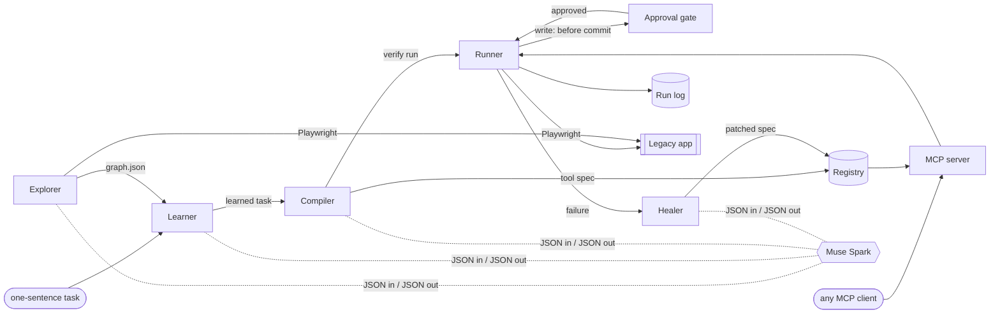

# Architecture

Status: draft for review (Oct 20, 2026). Code starts Oct 26.

This doc says how LegacyLink works inside. Its main job is to fix the two formats every component shares: the **screen graph** the explorer writes and the **tool spec** the compiler writes. Every later piece builds against those two formats, so changes to them go through this doc first.

The target for the build and the demo is [Contoso Order Entry](https://github.com/nuksee/contoso-order-entry), a WebForms-style web app with no API and live drift switches. Examples below use its screens.

## Contents

1. [Principles](#principles)
2. [Components](#components)
3. [The pipeline](#the-pipeline)
4. [Format 1: the screen graph](#format-1-the-screen-graph)
5. [Format 2: the tool spec](#format-2-the-tool-spec)
6. [Where Muse Spark is used](#where-muse-spark-is-used)
7. [Self-heal](#self-heal)
8. [Approval gate for writes](#approval-gate-for-writes)
9. [Run log](#run-log)
10. [Storage layout](#storage-layout)
11. [Demo mapping](#demo-mapping)
12. [Open questions](#open-questions)

## Principles

1. **The model writes data, never code.** Muse Spark outputs JSON that is validated against a schema: a screen graph patch, a tool spec, a locator fix. A fixed runner turns that JSON into Playwright calls. Nothing the model writes is `eval`ed.
2. **A healthy tool runs with no model call.** Run time is the runner, locators and post-conditions only, so it is fast, cheap and gives the same result every time.
3. **Every run proves itself.** A tool succeeds only when its post-condition passes. "No exception was thrown" is not success.
4. **Writes wait for a person.** A write tool fills the form, then stops before the commit step until someone approves what they can see.
5. **Everything leaves a record.** Every run, heal and approval is appended to the run log with screenshots.

## Components



| Component | Does | Calls Muse Spark |
| --- | --- | --- |
| Explorer | Crawls the app and writes the screen graph | Yes: picks what to try next, names screens and controls |
| Learner | Turns a one-sentence task into a path through the graph plus input/output fields | Yes |
| Compiler | Turns the learned task into a tool spec, then proves it with a verify run | Yes: drafts the spec. The verify run is deterministic |
| Runner | Executes a tool spec with Playwright and checks its post-condition | No |
| Registry | Stores tool specs, versioned | No |
| MCP server | Lists registry tools as MCP tools and routes calls to the runner | No |
| Approval gate | Holds write runs before the commit step until a person decides | No |
| Healer | Repairs a tool spec after drift | Yes: re-locates broken steps only |
| Run log | Append-only record of runs, heals and approvals | No |
| Console | Small local web page: tools, pending approvals, run log | No |

Default stack: TypeScript on Node 20+, Playwright for the browser, the official MCP TypeScript SDK, Ajv for JSON Schema validation. This matches the sample app and keeps one language end to end.

## The pipeline

```
explore ──► learn ──► compile ──► serve ──► (drift) ──► self-heal ──► serve
 graph       task      tool spec   runs      failed run   patched spec
```

### 1. Explore

Input: app base URL, login credentials, optional seed hints ("start at the main menu").
Output: `graph.json` (format 1).

The crawl loop:

1. Load a page. The deterministic part takes an accessibility snapshot, a list of interactive elements with candidate locators, and a screenshot.
2. Fingerprint the screen (see [Screen identity](#screen-identity)). If it's a known screen, merge; otherwise add a node.
3. Send Muse Spark the element list and screenshot. It returns: a screen name and purpose, a semantic name for each control (`customerId`, `saveOrder`), and which actions to try next.
4. Run the chosen safe actions (navigation links, menu items, search with sample values from visible data) and record each as an edge.
5. Stop at a page budget (default 30 screens) or when nothing unexplored is left.

The explorer never presses a control classified as `commit` (Save, Submit, Delete, Post). It records the edge as `unexplored` with the form fields it would submit. This keeps exploration free of side effects, so it can run against a real app. Commit edges are first exercised in the compiler's verify run, behind the approval gate.

### 2. Learn

Input: the graph and one sentence, for example "Create a sales order for a customer with up to three product lines".
Output: a learned task: the screen path, which controls are inputs, which elements are outputs, the commit step, and a draft input/output schema.

Muse Spark gets the graph (not screenshots, to keep the prompt small) and the sentence. It returns the learned task as JSON. The learner validates that every screen, control and edge it names exists in the graph, and retries once with the validation errors if not.

### 3. Compile

Input: learned task. Output: tool spec (format 2), registered as version 1.

1. Muse Spark drafts the tool spec: steps, schemas, post-condition, example input.
2. The compiler validates it against the tool spec schema and resolves every locator against the live app.
3. **Verify run:** the runner executes the spec with the example input. A read tool must pass its post-condition. A write tool runs up to the commit step, goes through the approval gate like any other write, then must pass its post-condition. The tool is registered only after a passing verify run.

### 4. Serve

The MCP server lists every registered tool. A call validates the input against `inputSchema`, runs the spec, checks the post-condition, validates the output against `outputSchema`, logs the run and returns the output. No model call happens on this path.

Runs are serialized per app: one Playwright browser, one logged-in context, one run at a time. Legacy apps often assume a single session per user, and serial runs keep the demo predictable.

### 5. Self-heal

A run that fails a locator or its post-condition goes to the healer, which patches only the broken steps, verifies the patch, bumps the tool version and retries. Details in [Self-heal](#self-heal).

## Format 1: the screen graph

The explorer's output and the learner's input. One file per app: `graph.json`. TypeScript types are the spec; a generated JSON Schema lives next to them in code.

```ts
interface ScreenGraph {
  formatVersion: 1;
  app: { name: string; baseUrl: string };
  exploredAt: string;              // ISO 8601
  screens: Screen[];
  edges: Edge[];
}

interface Screen {
  id: string;                      // stable slug, e.g. "new-sales-order"
  name: string;                    // "New Sales Order" (model-named)
  purpose: string;                 // one sentence (model-written)
  urlPattern: string;              // "/Orders/New.aspx"
  fingerprint: Fingerprint;
  requiresLogin: boolean;
  elements: Element[];
  screenshot: string;              // path under artifacts/
}

interface Fingerprint {
  title: string;                   // "Contoso Order Entry - New Sales Order"
  heading?: string;                // "New Sales Order"
  landmarks: string[];             // fieldset legends, grid ids: ["Customer", "Line Items"]
}

interface Element {
  key: string;                     // semantic name, unique per screen: "customerId", "saveOrder"
  kind: 'input' | 'select' | 'textarea' | 'button' | 'link' | 'gridLink' | 'output' | 'grid' | 'message';
  label?: string;                  // visible label: "Customer #:"
  intent: string;                  // what it's for, in words: "the customer's account number"
  locators: Locator[];             // ranked, best first
  role?: 'commit' | 'cancel' | 'navigate' | 'search';  // buttons and links
  required?: boolean;              // from validators or the model
  options?: { value: string; text: string }[];          // selects
  maxLength?: number;
}

type Locator =
  | { by: 'role'; role: string; name: string }        // getByRole('textbox', { name: 'Customer #:' })
  | { by: 'label'; text: string }                      // getByLabel('Customer #:')
  | { by: 'id'; id: string }                           // #ctl00_MainContent_txtCustomerId
  | { by: 'name'; name: string }                       // [name="ctl00$MainContent$txtCustomerId"]
  | { by: 'text'; text: string; exact?: boolean }
  | { by: 'css'; selector: string };                   // last resort

interface Edge {
  id: string;
  from: string;                    // screen id
  to: string | null;               // null while unexplored
  via: string;                     // element key on `from`
  kind: 'navigate' | 'search' | 'postback' | 'commit';
  fields?: string[];               // element keys the action submits
  status: 'explored' | 'unexplored';
}
```

### Screen identity

Two page loads are the same screen when the URL path matches `urlPattern` and the fingerprint's title or heading matches. Query strings are ignored, so `Details.aspx?id=C1001` and `?id=C1003` are one screen. Element ids are not part of identity, so a renamed control doesn't create a new screen; that is what lets the healer find the screen after drift.

### Locators

Each element keeps several locators, ranked. The runner tries them in order and takes the first that resolves to exactly one visible element. Ranking: role and accessible name, label, id, name, text, CSS. Ids and names are the most precise but the first to break when a vendor renames a control. Labels survive an id change but not a caption change. Keeping all of them is what makes a rename or a move recoverable, and the run log records which locator matched, so a tool that quietly fell back is visible before it fully breaks.

## Format 2: the tool spec

The compiler's output, the registry's unit, and the runner's input. One file per tool version: `tools/create_sales_order@3.json`.

```ts
interface ToolSpec {
  formatVersion: 1;
  name: string;                    // MCP tool name, snake_case, stable across versions
  version: number;                 // bumped by every heal or recompile
  description: string;             // shown to MCP clients
  access: 'read' | 'write';
  inputSchema: JSONSchema;         // draft 2020-12
  outputSchema: JSONSchema;
  steps: Step[];
  postcondition: Postcondition;
  errors: ErrorRule[];             // app-level failures that are not drift
  provenance: {
    task: string;                  // the one-sentence description
    graphExploredAt: string;
    compiledAt: string;
    model: string;                 // e.g. "muse-spark-1.1"
    healedFrom?: number;           // previous version, if this came from a heal
  };
  example: { input: object; output?: object };
}
```

### Steps

Steps are a small fixed vocabulary, not generated code. Each step that touches the page names its target element and carries the element's ranked locators and intent, copied from the graph, so the spec runs on its own and the healer knows what each step was for.

```ts
type Step =
  | { op: 'ensureLogin' }                                              // shared prelude, uses stored credentials
  | { op: 'goto'; screen: string; url: string }
  | { op: 'fill'; target: Target; value: Expr }
  | { op: 'select'; target: Target; value: Expr }
  | { op: 'click'; target: Target; commit?: true }                     // commit: true marks the approval point
  | { op: 'clickRow'; grid: Target; match: { column: string; value: Expr }; link: string }
  | { op: 'waitForScreen'; screen: string }
  | { op: 'extract'; target: Target; into: string; parse?: 'text' | 'money' | 'date' | 'int' }
  | { op: 'extractTable'; target: Target; into: string; columns: Record<string, string> }
  | { op: 'forEach'; items: Expr; steps: Step[] };                     // e.g. order lines

interface Target { key: string; intent: string; locators: Locator[] }

type Expr = string;   // "$input.customerId", "$item.sku", or a literal
```

The runner maps each op to Playwright calls with fixed timeouts (5 s per action, 15 s per screen wait). An optional `legacylink export` command writes a spec out as a readable Playwright `.spec.ts` for review, but the JSON is what runs.

Why JSON steps and not a generated script: the model's output can be validated before anything runs; a heal can patch one step's locators without regenerating the rest; diffs between versions are readable in the console; and there is no path from model output to arbitrary code execution.

### Post-condition

A post-condition is a list of checks that all must pass after the steps. Checks are deterministic.

```ts
interface Postcondition { checks: Check[] }

type Check =
  | { check: 'onScreen'; screen: string }
  | { check: 'visible'; target: Target }
  | { check: 'textMatches'; target: Target; pattern: string }          // regex
  | { check: 'outputMatches'; path: string; equals?: Expr; pattern?: string }
  | { check: 'readBack'; tool: string; input: Record<string, Expr>; expect: Record<string, Expr> };
```

`readBack` is how a write proves itself: after `create_sales_order`, the runner calls `get_order_status` with the new order number and checks the customer and status. The UI saying "saved" is one signal; the order being findable is the proof.

### Errors that are not drift

Some failures mean the app worked and said no: an unknown customer, a credit limit, a missing field. These must come back to the caller as typed errors and must never trigger a heal, or the healer would "fix" a tool by routing around a business rule.

```ts
interface ErrorRule {
  when: { target: Target; pattern?: string };   // e.g. the validation summary is visible
  code: string;                                  // "credit_limit_exceeded"
  message: Expr;                                 // the app's own text, extracted
}
```

`$text` in `message` is the matched element's text. The runner checks error rules after any commit or search step and before the post-condition. A matched rule ends the run as `app_error` with the code and message.

### Example: `create_sales_order`

```json
{
  "formatVersion": 1,
  "name": "create_sales_order",
  "version": 1,
  "description": "Key a new sales order into Contoso Order Entry. Needs approval before it is saved.",
  "access": "write",
  "inputSchema": {
    "type": "object",
    "required": ["customerId", "shipTo", "lines"],
    "properties": {
      "customerId": { "type": "string", "pattern": "^C\\d{4}$" },
      "shipTo": { "type": "string", "minLength": 1 },
      "poNumber": { "type": "string", "maxLength": 20 },
      "shipVia": { "enum": ["Ground", "2nd Day Air", "Next Day Air", "Will Call"] },
      "lines": {
        "type": "array", "minItems": 1, "maxItems": 3,
        "items": {
          "type": "object", "required": ["sku", "qty"],
          "properties": { "sku": { "type": "string" }, "qty": { "type": "integer", "minimum": 1, "maximum": 999 } }
        }
      }
    }
  },
  "outputSchema": {
    "type": "object",
    "required": ["orderNumber", "total"],
    "properties": { "orderNumber": { "type": "string", "pattern": "^SO-\\d+$" }, "total": { "type": "number" } }
  },
  "steps": [
    { "op": "ensureLogin" },
    { "op": "goto", "screen": "new-sales-order", "url": "/Orders/New.aspx" },
    { "op": "fill", "value": "$input.customerId", "target": {
        "key": "customerId", "intent": "the customer's account number",
        "locators": [
          { "by": "role", "role": "textbox", "name": "Customer #:" },
          { "by": "label", "text": "Customer #:" },
          { "by": "id", "id": "ctl00_MainContent_txtCustomerId" }
        ] } },
    { "op": "fill", "value": "$input.shipTo", "target": { "key": "shipTo", "intent": "shipping address", "locators": [ { "by": "label", "text": "Ship To:" } ] } },
    { "op": "forEach", "items": "$input.lines", "steps": [
        { "op": "select", "value": "$item.sku", "target": { "key": "product[$index]", "intent": "product for this line", "locators": [ { "by": "id", "id": "ctl00_MainContent_ddlProduct$line" } ] } },
        { "op": "fill", "value": "$item.qty", "target": { "key": "qty[$index]", "intent": "quantity for this line", "locators": [ { "by": "id", "id": "ctl00_MainContent_txtQty$line" } ] } }
    ] },
    { "op": "click", "commit": true, "target": {
        "key": "saveOrder", "intent": "save the order",
        "locators": [
          { "by": "role", "role": "button", "name": "Save Order" },
          { "by": "id", "id": "ctl00_MainContent_btnSave" }
        ] } },
    { "op": "extract", "into": "orderNumber", "target": { "key": "savedOrderNumber", "intent": "number of the order just saved", "locators": [ { "by": "id", "id": "ctl00_MainContent_lblOrderNumber" } ] } }
  ],
  "errors": [
    { "code": "validation_failed", "message": "$text",
      "when": { "target": { "key": "validationSummary", "intent": "list of form errors", "locators": [ { "by": "id", "id": "ctl00_MainContent_ValidationSummary1" } ] } } }
  ],
  "postcondition": { "checks": [
    { "check": "textMatches", "pattern": "saved for customer", "target": { "key": "message", "intent": "result message", "locators": [ { "by": "id", "id": "ctl00_MainContent_lblMessage" } ] } },
    { "check": "readBack", "tool": "get_order_status", "input": { "orderNumber": "$output.orderNumber" },
      "expect": { "customerId": "$input.customerId", "status": "Open" } }
  ] },
  "provenance": { "task": "Create a sales order for a customer with up to three product lines", "graphExploredAt": "2026-10-27T15:02:11Z", "compiledAt": "2026-10-29T10:40:00Z", "model": "muse-spark-1.1" },
  "example": { "input": { "customerId": "C1003", "shipTo": "Adventure Works\n22 Harbor Way\nPortland, OR 97209", "lines": [ { "sku": "P-200", "qty": 5 } ] } }
}
```

(Some locators are trimmed for length. `$index` is 0-based, `$line` is `$index + 1`.)

## Where Muse Spark is used

The model is called in four places, all offline from a healthy tool's run path.

| Stage | Model gets | Model returns | Deterministic guard |
| --- | --- | --- | --- |
| Explore | Element list, screenshot, graph so far | Screen name and purpose, element keys and intents, roles (`commit` etc.), next actions | Never clicks a `commit` control; page budget; graph schema validation |
| Learn | Graph, one-sentence task | Learned task: path, inputs, outputs, commit step | Every referenced screen, element and edge must exist in the graph |
| Compile | Learned task, graph excerpts | Tool spec draft | Tool spec schema; every locator resolves live; verify run must pass |
| Heal | Failed step, its intent, the current screen's element list and screenshot | A replacement `Target` for each broken step | Patch may only change targets; verify run must pass; write commits still need approval |

Rules for every model call:

- Structured output only: each call has a JSON Schema, the response is validated with Ajv, and an invalid response gets one retry with the errors attached. A second failure fails the stage with the model's raw output in the run log.
- Temperature 0 where the API allows it.
- Prompts live in `prompts/*.md`, versioned with the code. Each call logs prompt id, input hash, token counts and latency.
- **Record and replay.** Every model call is stored by input hash in `.legacylink/model-cache/`. With `LEGACYLINK_MODEL=replay`, calls are served from the cache and a miss is an error. The live demo can then run against recorded answers if the API is slow or down, and the same inputs always give the same outputs during rehearsal.

Not yet confirmed: whether Muse Spark's API exposes computer use (an open item in [plan.md](plan.md)). This design doesn't depend on it. The explorer drives the browser itself and sends the model element lists and screenshots, which only needs image input and JSON output. If computer use is available, the explorer can use it for the "what to try next" step without changing either format.

What stays deterministic, always: the runner, locator resolution, input and output validation, error rules, post-conditions, the approval gate, the run log, and screen identity.

## Self-heal

### Triggers

A run goes to the healer when:

- a step's target resolves to zero elements, or more than one, with every locator (`locator_failed`), or
- the post-condition fails after all steps ran (`postcondition_failed`).

A matched error rule (`app_error`), invalid input, or a timeout while the app is unreachable never trigger a heal.

### Steps

1. **Capture.** The runner already holds the page at the failing step. It takes a screenshot and a fresh element list for that screen.
2. **Re-locate.** For each step whose target failed, the healer first tries deterministic matching against the new element list: same label, same role and accessible name, same id after a common prefix change. If one candidate matches, no model call is needed.
3. **Ask the model** only for targets still unresolved. It gets the step's `intent`, old locators, the new element list and the screenshot, and returns a new `Target` per step.
4. **Patch.** Only `target` fields of failing steps change. Steps, schemas, error rules and post-conditions stay as they are. The patched spec is checked against the tool spec schema.
5. **Verify.** For a read tool, rerun the original call with the patched spec; the post-condition must pass. For a write tool, see below.
6. **Commit the heal.** Save as `version + 1` with `provenance.healedFrom`, update the graph's elements for that screen, send MCP `notifications/tools/list_changed`, log a `heal` event with a before/after diff, and return the original call's result.

Limits: one heal attempt per run, three heals per tool per hour. Past that, the tool is marked `broken` in the registry, calls fail fast with a clear error, and the console shows it.

### Healing a write without writing twice

If a write fails before its commit step, nothing was saved: heal, then continue from the commit step through the approval gate as usual.

If it fails after the commit step (for example, the success message moved), the order may already exist. Before any retry the healer runs a duplicate check: a read-back that looks for the order by its distinguishing input (PO number, or customer plus the run's timestamp). If it exists, the heal only fixes the post-condition targets and the run completes without a second commit. If the duplicate check can't decide, the run fails and asks a person.

## Approval gate for writes

1. A client calls a write tool. The runner validates input and runs every step before the `commit: true` click.
2. The runner pauses, holding the browser on the filled form, and creates an approval request: tool, version, input, a screenshot of the filled form, and whether the tool was healed since it was last approved.
3. The request shows in the console with Approve and Reject. The MCP call stays open while it waits.
4. On approve: the runner clicks commit and continues. On reject or timeout (default 5 minutes): the runner navigates away without committing, and the call returns `rejected` or `approval_timeout`.
5. The decision, who made it, and when go into the run log.

A tool whose latest version came from a heal is flagged "changed since last approval" on its next approval, so a person sees when the automation they are approving is not the one they approved before.

The approval UI is the LegacyLink console, not the MCP client. MCP elicitation would let some clients show the request inline, but support varies by client, and the demo needs one place that always works. Elicitation can be added later as a second way to answer the same request.

## Run log

Append-only JSON Lines, one file per day: `runs/2026-11-03.jsonl`. One line per event; events of one run share a `runId`.

```ts
type RunEvent =
  | { type: 'run_started'; runId: string; at: string; tool: string; version: number; access: 'read' | 'write'; input: object; caller?: string }
  | { type: 'step'; runId: string; at: string; index: number; op: string; key?: string; matchedLocator?: number; ms: number; ok: boolean; error?: string }
  | { type: 'approval_requested'; runId: string; at: string; screenshot: string; healedSinceLastApproval: boolean }
  | { type: 'approval_decided'; runId: string; at: string; decision: 'approved' | 'rejected' | 'timeout'; by?: string }
  | { type: 'heal'; runId: string; at: string; fromVersion: number; toVersion: number; reason: 'locator_failed' | 'postcondition_failed'; changedSteps: number[]; usedModel: boolean; diff: string }
  | { type: 'model_call'; runId?: string; at: string; stage: 'explore' | 'learn' | 'compile' | 'heal'; prompt: string; inputHash: string; tokensIn: number; tokensOut: number; ms: number; cached: boolean }
  | { type: 'run_finished'; runId: string; at: string; outcome: 'ok' | 'app_error' | 'rejected' | 'approval_timeout' | 'failed'; output?: object; error?: { code: string; message: string }; postcondition: 'passed' | 'failed' | 'skipped'; ms: number };
```

`matchedLocator` above 0 means the step fell back from its first-choice locator, an early sign of drift. Secrets (the login password, any input field marked `"x-secret": true` in the schema) are written as `"***"`. Screenshots go under `artifacts/<runId>/`.

## Storage layout

All state for one target app lives in one folder, so a demo can be reset by copying it.

```
.legacylink/
  config.json            # app base URL, credentials ref (env var name), timeouts
  graph.json             # format 1
  tools/
    get_customer_details@1.json
    get_order_status@1.json
    create_sales_order@1.json
    create_sales_order@2.json      # healed
    registry.json                  # current version and status per tool
  runs/2026-11-03.jsonl
  artifacts/<runId>/*.png
  model-cache/<inputHash>.json
```

Proposed code layout for this repo:

```
src/
  formats/      # ScreenGraph and ToolSpec types, JSON Schemas, validators
  explorer/
  learner/
  compiler/
  runner/       # step ops, locator resolution, post-conditions, error rules
  healer/
  mcp/          # MCP server (stdio and streamable HTTP)
  approval/
  runlog/
  console/      # local web page: tools, approvals, run log
  model/        # Muse Spark client, record/replay cache
prompts/
docs/
```

`src/formats` is built first, on Oct 26, before any component that uses it.

## Demo mapping

| Tool | Access | Screens | Post-condition |
| --- | --- | --- | --- |
| `get_customer_details` | read | Customer Inquiry → `__doPostBack` Select → Customer Details | On Customer Details; `customerId` in output equals input |
| `get_order_status` | read | Order Status | Order # label equals input; status is one of the known values |
| `create_sales_order` | write | New Sales Order | Success message; read-back via `get_order_status` |

How the sample app's drift switches exercise the healer:

| Switch | Breaks | Heal path |
| --- | --- | --- |
| Rename | `txtCustomerId`, `btnSave` on New Order; `txtOrderNumber`, `btnLookup` on Order Status. Labels change too ("Account No.", "Submit Order", "Find") | id, name, label and role locators all miss; the model maps intent ("the customer's account number") to the renamed control |
| Move | Save button moves to a toolbar above the form, Submit first | Role and id locators still match, so the step passes with no heal. Shows that position is never used for location |
| Rename and move | Both | Same as rename; the healed spec is shown passing |

Demo script outline: run all three tools, approve one order, flip Rename in `/__admin`, call `create_sales_order` again, watch it fail, heal (version 1 to 2) and stop at the approval gate flagged as changed, approve, show the read-back and the run log diff. Reset with `/__admin/reset`.

## Open questions

- Muse Spark API details: computer use, image input limits, structured output support, rate limits. Affects the model client, not the formats.
- Whether `forEach` is needed beyond order lines, or a fixed number of line slots is simpler. Default: keep `forEach`.
- Whether a desktop target (pyautogui or UI Automation) is in scope. Default: no. The formats leave room for it, since `Locator` can gain new `by` kinds, but the runner is web-only for the hackathon.
