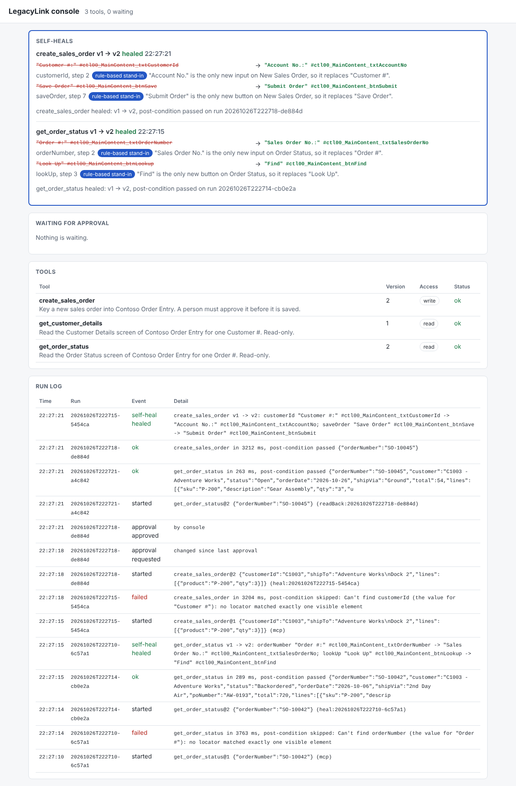

# Self-heal

When a vendor patch renames or moves a control, a compiled tool stops finding it. The healer repairs the tool during the same call: it finds the control's replacement on the screen, patches the tool spec, runs the call again with the patch, and keeps the patch as the tool's next version only if that run passes its post-condition. Code: [src/healer/heal.ts](../src/healer/heal.ts). Design: [architecture.md](architecture.md#self-heal).



## Run it

Nothing to switch on. `serve` and `run` heal by default. Put the explorer's graph in the state folder (`.legacylink/graph.json`): the healer uses it to tell the screen's known controls from new ones, and updates it after a heal.

```sh
# Contoso on :5080, the demo tools in .legacylink/ (see compiler.md)
export LEGACYLINK_PASSWORD=demo
curl -X POST localhost:5080/__admin/drift -H 'content-type: application/json' -d '{"rename":true,"move":true}'
npm run legacylink -- run get_order_status '{"orderNumber":"SO-10042"}'
```

The heal is printed on stderr:

```
[heal] get_order_status v1 broke at step 2 (Can't find orderNumber (the value for "Order #"): no locator matched exactly one visible element)
[heal]   orderNumber: "Order #:" #ctl00_MainContent_txtOrderNumber -> "Sales Order No.:" #ctl00_MainContent_txtSalesOrderNo (muse-spark-1.3: ...)
[heal]   lookUp: "Look Up" #ctl00_MainContent_btnLookup -> "Find" #ctl00_MainContent_btnFind (muse-spark-1.3: ...)
[heal]   retrying as v2; it is kept only if its post-condition passes
[heal] get_order_status healed: v1 -> v2, post-condition passed on run 20261103T101500-ab12cd
```

The same heal shows up in four more places, so the demo audience can't miss it:

- **Console** ([http://127.0.0.1:5180](http://127.0.0.1:5180)): a "Self-heals" panel at the top with each control struck out and its replacement, the reason, and who picked it (the model, the rule-based stand-in, or an exact match). The run log gets a `self-heal` row.
- **MCP client**: the call's result carries a second text item, `[LegacyLink self-heal] get_order_status healed: v1 -> v2 ...`, next to the output. The server also sends `notifications/tools/list_changed`.
- **Approval request**: a healed write's request is flagged "Changed since last approval" and lists what the heal changed, above the screenshot of the filled form.
- **Run log**: a `heal` event (below) and the retry's own `run_started` with `caller: "heal:<failed run>"`.

### Model modes

The healer asks Muse Spark through the same client as the explorer and learner, so the same switches apply (`--model` on `run` and `serve`, or `LEGACYLINK_MODEL`):

| Mode | Heal answers come from |
| --- | --- |
| `live` (default with `MODEL_API_KEY`) | Muse Spark. Every answer is recorded in `.legacylink/model-cache/`. |
| `replay` | Recorded answers only. Use it for rehearsals and the demo itself after one live run. |
| `heuristic` (default without a key) | The rule-based stand-in ([src/model/heal-heuristic.ts](../src/model/heal-heuristic.ts)). |

[examples/contoso/model-cache/](../examples/contoso/model-cache/) holds live Muse Spark answers recorded on 2026-10-26 for the three demo tasks' learn calls and every heal in the demo sequence: Rename on, Rename off (heal back), Rename + Move on, all off, each followed by `create_sales_order`, `get_order_status` and `get_customer_details`. Copy the folder into `.legacylink/` with the tools and run with `--model replay`: every heal then comes from Muse Spark's recorded answer with no network, and a heal the recordings don't cover falls back to the stand-in, as below.

If a live or replay call fails (network, API error, no recording, an answer that fails validation twice), the healer says so on stderr and uses the stand-in, so a flaky API can't break the demo. The console badge shows which one decided.

## How a heal works

1. **Triggers.** A run that ended `failed` with `locator_failed` (a control matched nothing) or `postcondition_failed`. `app_error`, invalid input and an unreachable app never heal. A `locator_failed` from the wrong screen loading (no control named) doesn't either: that's a navigation change, not a renamed control.
2. **Write safety.** A write that failed at or after its commit step is never retried: the record may already be saved. The heal is logged as `failed` with "a person needs to check". The runner now also finds the commit button before it asks for approval, so a renamed Save button fails (and heals) before anyone is asked, not after.
3. **What's broken.** The healer captures the page as it is now (the explorer's snapshot), then resolves every control the screen is known to have: the tool's own targets on that screen and the graph's elements for it. The ones that still resolve claim their element. The broken ones are the failing control plus any other control of the same page state (from the screen's entry to the next click) that no longer resolves, so Rename on New Order fixes both Customer # and Save Order in one heal.
4. **Re-locate each broken control**, using only the elements nobody claimed:
   - **Exact match**, no model: a new element with the old id's last part (`ctl00_Body_txtCustomerId` for `ctl00_MainContent_txtCustomerId`) or the old caption.
   - **Muse Spark** ([prompts/heal-target.md](../prompts/heal-target.md)): it gets the missing control's key, intent, old caption and locators, the candidate elements and a screenshot, and answers `{ "ref": "e7" | null, "reason": "..." }`. It picks a candidate; it never writes a locator.
   - **Rules every answer must pass**, the model's included ([eligible](../src/model/heal-heuristic.ts)): a `fill` needs an input, a `click` a button or link, and so on. A commit click must land on a button that looks like a commit (Save, Submit, ...), and a non-commit click can never land on one. So a heal can't make a read press Save, or point a write's Save at Delete. A refused answer goes back to the model once with the reason, then to the stand-in.
5. **Patch.** New locators are built from the chosen element the way the explorer builds them, keeping only those that pick out exactly that element. Only `target.locators` change, for those keys on that screen. Steps, schemas, error rules, post-conditions and the commit flag stay as they were. The patch is `version + 1` with `provenance.healedFrom` and is checked against the tool spec schema.
6. **Verify.** The call runs again with the patched spec. A write's retry stops at the approval gate like any other run, flagged as changed and listing the heal.
7. **Keep or drop.**

| Retry | Heal status | What happens |
| --- | --- | --- |
| `ok` | `healed` | The patch is registered as the current version, the graph gets the new locators and caption, MCP clients get `tools/list_changed`, and the retry's result goes back to the caller. |
| `rejected` / `approval_timeout` | `unverified` | Nothing is registered. The next call heals again (from the model cache, so it's quick). |
| anything else | `failed` | Nothing is registered. The retry's error goes back to the caller. |

A run heals at most once. A readBack inside a write heals its own read tool if it needs to (Rename breaks both `create_sales_order` and its readBack `get_order_status`, and one call fixes both). More than 5 heals of one tool in an hour (`LEGACYLINK_MAX_HEALS_PER_HOUR`) marks it `broken` in the registry; the MCP server stops listing it until it's recompiled. The count lives in the server process, so restarting `serve` before the demo resets it.

### The heal event

```ts
{ type: 'heal'; runId: string /* the failed run */; at: string; tool: string; fromVersion: number; toVersion?: number;
  reason: 'locator_failed' | 'postcondition_failed'; status: 'healed' | 'unverified' | 'failed';
  changes: { step: number; key: string; before: string; after: string; via: 'deterministic' | 'model' | 'heuristic'; why: string }[];
  usedModel: boolean; model: string; retryRunId?: string; message: string }
```

`before`/`after` read like `"Customer #:" #ctl00_MainContent_txtCustomerId`. The screenshot the healer worked from is `artifacts/<runId>/heal.png`.

## Against Contoso

| Drift | What happens |
| --- | --- |
| Move | Nothing to heal: buttons are found by role and id, not position. |
| Rename | `get_order_status`: `orderNumber` and `lookUp` heal to Sales Order No. and Find. `create_sales_order`: `customerId` and `saveOrder` heal to Account No. and Submit Order before the approval request, and its readBack heals `get_order_status` if that hasn't healed yet. `get_customer_details` is untouched. |
| Rename off again | The tools heal back to the original controls (v3). |

[test/contoso.test.ts](../test/contoso.test.ts) checks all three with `CONTOSO_URL` set. [test/healer.test.ts](../test/healer.test.ts) runs in CI on the fixture app: a read and a write heal through MCP, a rejected heal keeps v1, drift after the commit isn't retried, renaming back heals back, and the model's pick is used with the stand-in as fallback.

## Not healed yet

- Repeated row controls (`product$line`). Contoso's rename doesn't touch them.
- A post-condition that fails with every control still found, such as a value that moved to another element with the same id. The heal is logged as `failed` and the call fails as before.
- A changed navigation path (a screen that no longer loads from its URL).
